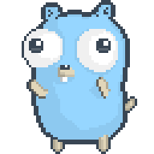

<h1 align="center">Driane Diojan Perez</h1>

Fullstack software engineer · Belize City, Belize

  

  
  
  
  

## About

I'm a fullstack software engineer working full-time in Belize, and I build terminal tools, CLI apps, and desktop software on the side.

I'm part self-taught and part formally trained. I work across the whole stack, from clean, minimal interfaces to fast backend APIs, and I care most about performance, simple design, and good developer tooling.

- **Work with:** React, React Native, TypeScript, Tailwind CSS, Go, and Rust
- **Interested in:** TUI and CLI tools, desktop apps, web, and mobile
- **Learning:** Rust in depth, cloud-native development, and DevOps with Docker, Jenkins, and Grafana
- **Open to:** collaborating on open source projects

## Projects

| Project | Description | Stack |
|---|---|---|
| **[lazyssh](https://github.com/DrianeDiojanPerez/lazyssh)** | A terminal app for your SSH hosts. Reads and edits `~/.ssh/config`, shows which hosts are up, and opens each connection in its own tab. | Rust, ratatui |
| **[helperpad](https://github.com/DrianeDiojanPerez/helperpad)** | Topaz signature pads in Chrome and Firefox on Linux, through the SigPlusExtLite extension. | Rust |
| **[nvim](https://github.com/DrianeDiojanPerez/nvim)** | A small Neovim setup for servers, with one script to install it on a new machine. | Lua |

## Languages and tools

**Frontend**

**Backend and DevOps**

**Databases and tools**

## GitHub stats

  

  
  

  

## Contact

- Email: [drianeperez12@gmail.com](mailto:drianeperez12@gmail.com)
- LinkedIn: [driane-perez-abb156172](https://linkedin.com/in/driane-perez-abb156172)
- WhatsApp: [+501 672-7351](https://wa.me/5016727351)
